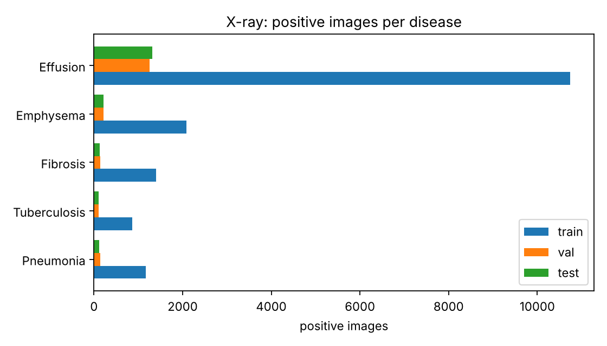
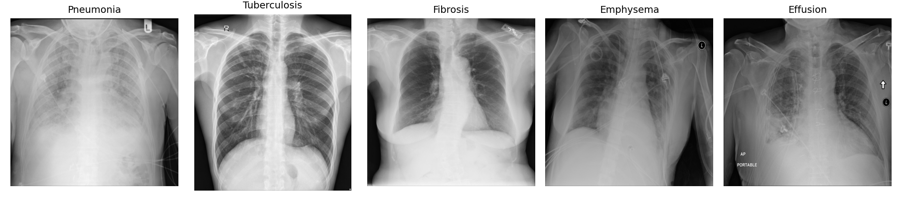
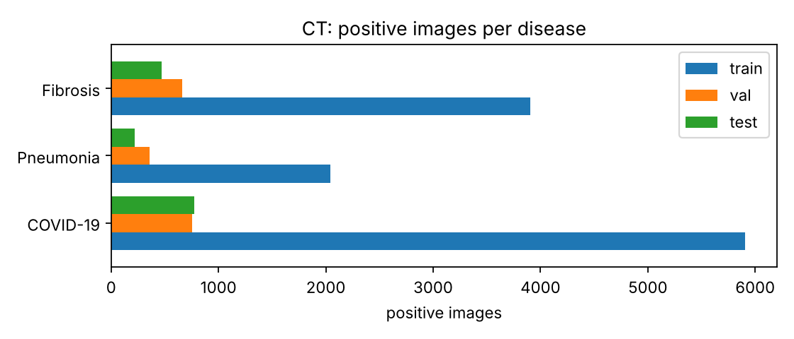
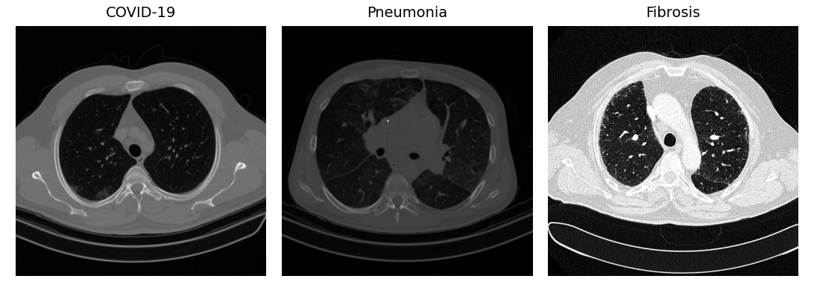
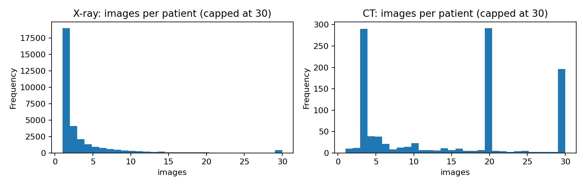

# Module 1: dataset statistics

Generated by `scripts/module1_report.py` from the split manifests after duplicate removal and patient-level splitting.

## X-ray

- Images: **113,598**  ·  Patients: **32,308**  ·  Datasets: montgomery, nih, shenzhen, tb_kaggle
- Patients appearing in more than one split: **0** (must be 0)

### Images and patients per split

| split   |   images |   patients |
|:--------|---------:|-----------:|
| train   |    91853 |      25845 |
| val     |    10911 |       3233 |
| test    |    10834 |       3230 |

### Images per dataset and split

| source     |   test |   train |   val |
|:-----------|-------:|--------:|------:|
| montgomery |     14 |     113 |    11 |
| nih        |  10680 |   90653 | 10761 |
| shenzhen   |     69 |     527 |    66 |
| tb_kaggle  |     71 |     560 |    73 |

### Positive (+) and negative (-) images per disease

Images from datasets that don't label a disease are counted as *not labelled* and are ignored in training for that disease.

| disease      |   train + |   train - |   val + |   val - |   test + |   test - |   not labelled |
|:-------------|----------:|----------:|--------:|--------:|---------:|---------:|---------------:|
| Pneumonia    |      1167 |     89486 |     143 |   10618 |      121 |    10559 |           1504 |
| Tuberculosis |       861 |      3173 |     112 |     368 |      112 |      365 |         108607 |
| Fibrosis     |      1403 |     89250 |     147 |   10614 |      136 |    10544 |           1504 |
| Emphysema    |      2088 |     88565 |     218 |   10543 |      210 |    10470 |           1504 |
| Effusion     |     10742 |     79911 |    1258 |    9503 |     1315 |     9365 |           1504 |

## CT

- Images: **21,751**  ·  Patients: **1,049**  ·  Datasets: ct_covid, osic
- Patients appearing in more than one split: **0** (must be 0)

### Images and patients per split

| split   |   images |   patients |
|:--------|---------:|-----------:|
| train   |    17184 |        840 |
| val     |     2370 |        103 |
| test    |     2197 |        106 |

### Images per dataset and split

| source   |   test |   train |   val |
|:---------|-------:|--------:|------:|
| ct_covid |   1726 |   13279 |  1708 |
| osic     |    471 |    3905 |   662 |

### Positive (+) and negative (-) images per disease

Images from datasets that don't label a disease are counted as *not labelled* and are ignored in training for that disease.

| disease   |   train + |   train - |   val + |   val - |   test + |   test - |   not labelled |
|:----------|----------:|----------:|--------:|--------:|---------:|---------:|---------------:|
| COVID-19  |      5908 |      7371 |     752 |     956 |      773 |      953 |           5038 |
| Pneumonia |      2041 |     11238 |     359 |    1349 |      218 |     1508 |           5038 |
| Fibrosis  |      3905 |      5330 |     662 |     597 |      471 |      735 |          10051 |

## Duplicate removal

Public lung datasets re-share each other's images, so every image was fingerprinted (256-bit perceptual hash) before splitting.

| | Exact duplicates removed | Near-duplicates removed (different patient, ≤ 8 of 256 bits) | Of which copies from another dataset |
|:--|--:|--:|--:|
| X-ray | 2,098 | 1,424 | 1,422 |
| CT | 273 | 120 | 0 |

- 3,487 of the 3,500 "Normal" images in the TB Chest X-ray Database are copies of NIH ChestX-ray14 images. The NIH copy was kept and its missing Tuberculosis label was filled with the TB database's label (negative), so TB has 3,906 negative images without any duplicate image.
- CT slices are grouped by patient or scan using the file-name conventions of each source, so neighbouring slices of one scan are never split across train and test.

## Images per patient

Many patients have several images, which is why the split is done by patient: otherwise the same patient could appear in training and test, and test accuracy would be inflated.

- X-ray: median 1, max 184 images per patient
- CT: median 18, max 212 images per patient
